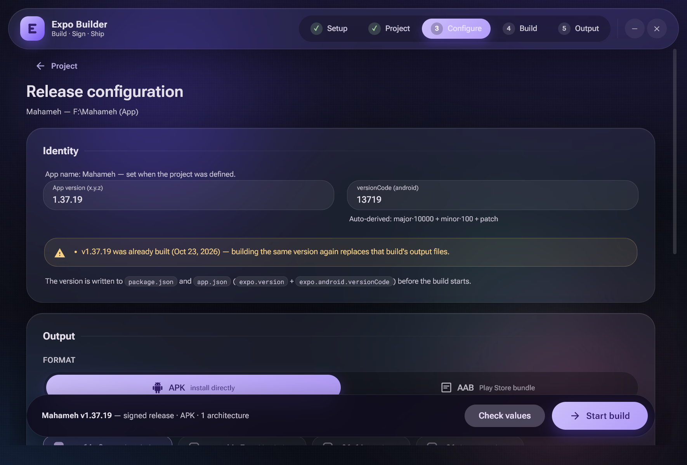

# Expo Builder

A local Material 3 Expressive desktop app (Electron) that builds and signs **any Expo project** on Windows — a generalization of the original `Mahameh (App)/scripts/build-local.sh` GitLab-CI replica.



## Download

A ready-to-run Windows installer is attached to the [latest release](https://github.com/aliehtesham/Expo-Builder/releases/latest) — download **`Expo-Builder-Setup-1.8.4.exe`**, run it, and follow the setup wizard (the app itself checks all build prerequisites on first launch).

To build the installer yourself instead: `npm install && npm run dist` → `dist/Expo Builder Setup 1.8.4.exe`.

## Run it

```bash
npm install
npm start
```

The app is written in **TypeScript** (strict mode). `npm start` compiles everything first (`npm run build`): main-process sources → `out/`, renderer sources (`renderer/src/`) → `renderer/assets/`, dev scripts in place. Compiled output is gitignored — the build step is always part of `start`/`smoke`/`dist`.

Requirements on the machine (same as building by hand) — the app **checks all of them itself** on the first page before anything else:

- **Git for Windows** (bash + MSYS tools) — the build script runs through Git Bash
- **Node** (+ npm; yarn/pnpm/bun optionally, matching the target project)
- **JDK 17+** with `java` + `keytool` (`JAVA_HOME`, PATH, or Android Studio's bundled JDK)
- **Android SDK** (`ANDROID_HOME` / `ANDROID_SDK_ROOT` / `%LOCALAPPDATA%\Android\Sdk`) with **platform-tools**, **build-tools**, an **Android platform**, the **NDK** and **CMake**

## The flow

0. **Setup (environment gate)** — the app opens on a dependency check, not the picker. It probes the machine (read-only, nothing is installed): Node/npm, the optional package managers, Git Bash, the JDK (version + `keytool`), the Android SDK root and inside it platform-tools (`adb`), build-tools (`aapt`/`apksigner`/`zipalign`), the newest platform, the NDK and the SDK's CMake (+ bundled ninja). Each row shows the detected version/path — or what to install and where — with **Continue locked until every required tool is found**; missing optional package managers only turn the row gray. A *Check again* button re-runs everything after you install something, no restart needed.
   - **Newer-version detection & one-click update** — right after the probes, the page checks what the *newest suitable* release of every build dependency is and marks rows that have one with a **purple version chip** (`↑ 4.1.2`), plus a summary line ("N newer stable releases available"). Sources: Google's Android SDK repository manifest (`dl.google.com/android/repository/repository2-*.xml`, with `sdkmanager --list` as a fallback) for platform-tools / build-tools / platforms / NDK / CMake, nodejs.org for the current **Node LTS**, and adoptium.net for **Temurin JDK 21 LTS**. Only stable releases count — previews (-rc/-beta/canary) are listed inside the detail dialog as "not recommended for release builds". Clicking a chip opens the detail dialog: installed vs. latest, the source it was checked against, and an **Update now** button. SDK components download & install **through Google's own `sdkmanager`** (side-by-side — your current version stays, licenses auto-accepted, live progress bar with sdkmanager's output and a cancel button; one update at a time, and installs are blocked while a build runs and vice-versa). Node and JDK touch system locations, so their **official MSI installer is downloaded into your Downloads folder and opened** — you finish the wizard, then hit *Check again*. After a successful install the page re-probes and refreshes automatically (bypassing the 10-minute version cache). Offline, the detection degrades gracefully (the chip line reports that no source was reached).
1. **Project** — pick a folder with the native Windows directory picker. The app validates it is an Expo project (`package.json` with an `expo` dependency + `app.json`/`app.config.js`), then immediately asks you to **name the project** (prefilled with the detected name). Confirming defines the picked folder as a project under that name — this name is what `APP_NAME` uses downstream. Every defined project is remembered in a **"Your projects" list** on this page (localStorage): click an entry to re-validate and reopen it, or remove it with the trash button. Picking a folder that is already listed prefills its saved name. When a project is open, a **Build history** card lists every recorded build of that project (version, format, signing, success/failed status, date, duration, file count) — click an entry to see its **build details**: full settings plus every output file with Save / reveal actions (files no longer on disk are struck through and marked). The saved-projects rows and the project card also show the latest built version, and the trash button on the card clears the history.
2. **Configure**
   - **App version** (`x.y.z`) — **prefilled from `app.json`** (`expo.version`, falling back to `package.json`), re-read every time the project opens; written into `package.json`, `app.json` `expo.version` and `expo.android.versionCode` before the build; the versionCode is auto-derived as `major·10000 + minor·100 + patch` (1.37.18 → 13718) and stays editable
   - **Version warnings** (from the project's build history): typing a version that was **already built** warns that rebuilding replaces that build's output files; typing a version **lower than the last built one** warns that a lower versionCode can block updates. Pressing *Start build* on an already-built version asks for confirmation first — it lists the previous build's files (marking already-deleted ones) and offers *Build without deleting* or *Delete old files & build* (old files go to the **Recycle Bin**, never permanently deleted)
   - **Sign the app** checkbox — when on: key alias, key password, keystore password (password fields with show/hide + a built-in generator with strength meter), and a searchable country picker (249 ISO countries) for the certificate dname
   - **Password vault** — the signing passwords are saved **encrypted** (Chromium `safeStorage` → Windows DPAPI, bound to the current Windows user, in `userData/password-vault.json` per project) whenever one is generated or a build starts. The next time the project's form opens, a **Windows Hello** consent prompt (fingerprint / PIN / face, via `UserConsentVerifier` in `resources/verify-hello.ps1`) unlocks and autofills them — while the OS prompt is on screen the whole app freezes behind a blurred *Confirm it's you* overlay (with a working **Cancel** that dismisses the prompt), and on success the overlay fades and the two password fields flash where the values landed; the fingerprint button in the Signing card re-runs it, the trash button beside it forgets the entry. If Hello is not configured on the machine the entry still decrypts under DPAPI user isolation and the app says so. Set `AB_NO_HELLO=1` to skip the prompt in tests/CI
   - **Lost-password recovery (asking mode)** — when a build aborts because the passwords don't unlock the project's keystore (`keytool` validation, marked `@@KEYFAIL` by the build script), a dedicated dialog asks what to do: **Archive old key & build** renames `android-key/` to `android-key-old/` (numbered `-2`, `-3`… on collisions — nothing is ever deleted) and restarts the build, which generates a fresh keystore with the passwords currently in the form; **Keep the old key** closes the dialog untouched; **Run in debug mode** re-runs with more detail. The dialog warns that old installs need uninstall/reinstall (new signature) and that Play Store apps need an upload-key reset (Play Console → Setup → App signing)
   - **Format** — APK or AAB; for APK pick architectures (arm64-v8a, armeabi-v7a, x86_64, x86 — all selected by default)
   - **Advanced** — **Target Android SDK** (API level select, 24–37): pins `targetSdkVersion` for this build by writing it into `android/gradle.properties` after prebuild — the expo-root-project Gradle plugin honors an existing property over its per-SDK default, so the pin wins for the build but never leaks into committed files (`expo prebuild --clean` regenerates the folder every run). When the chosen level is higher than the toolchain's `compileSdk` default (read from `node_modules/react-native/gradle/libs.versions.toml`), `compileSdkVersion` is raised to match or AGP would reject the build. Leave at *project default* unless a store policy or device-support need says otherwise. Plus: redirect heavy Gradle output to `C:\ExpoBuilds\<project>` via NTFS junctions (the F:-drive protection from the original script; on by default)
3. **Build** — every command streams into the console line by line with phase tracking and elapsed time; cancel anytime. On failure the app asks: *"Do you want to run it again in debug mode with stack-trace and more details?"* — the rerun adds `set -x`, gradle `--stacktrace --info`.
4. **Output** — every produced APK/AAB plus `android-key.jks` (the persistent signing key from `android-key/`) with individual Save buttons, **Download ZIP** (outputs + keystore in one archive), and open-folder shortcuts. Finishing a build records it in the project's **build history** (localStorage `ab.builds`, newest first, 50 per project) with its version, settings and output files.

## Signing model (unchanged from the original script)

- The **`android-key/`** folder at the project root holds the persistent keystore (`android-key.jks`). If it exists it is **validated** against the alias/passwords and reused; if not, a 2048-bit RSA / 10000-day key is generated once.
- A working copy is placed at `android/app/<Name>.v<version>.jks` and wired into `android/gradle.properties` (`MYAPP_UPLOAD_*`).
- If a project ships `scripts/verify-signing.sh` (like Mahameh), it runs after an APK build.

## Project layout

```
main.ts                  Electron main (IPC, environment gate + newer-version watch, build wiring, log streaming, zip, save dialogs)
preload.ts               contextBridge API
lib/types.d.ts           shared ambient types for main + preload + renderer (IPC payloads, build records…)
lib/project-info.ts      Expo validation + version writing (also a CLI: node out/lib/project-info.js <dir>)
lib/env-check.ts         dependency detection for the setup gate (also a CLI: node out/lib/env-check.js)
lib/sdk-updates.ts       newest-release detection for the deps page (also a CLI: node out/lib/sdk-updates.js)
lib/sdk-install.ts       update action: sdkmanager installs (license feed, progress) + MSI downloads
resources/expo-build.sh  generalized build script (env-driven, @@PHASE/@@ARTIFACT markers)
renderer/                UI — hand-rolled Material 3 Expressive dark glass theme
  index.html
  assets/m3.css          design tokens + components (buttons, fields, chips, dialogs…)
  assets/app.css         page layout
  src/app.ts             5-page flow (setup → project → configure → build → output), form logic/validation, console, generator
  src/countries.ts       ISO 3166 country data
  assets/app.js          compiled from src/ by `npm run build` (gitignored)
out/                     compiled main-process JS — package.json "main" points here (gitignored)
tools/make-icons.ts      icon generator (npm run icons)
.smoke/*.ts              QA harnesses, compiled in place by the build
```

## Testing

```bash
npm run smoke          # boots the app, walks all pages with mock data, screenshots into .smoke/
node out/lib/project-info.js "F:/Some Expo Project"   # validate a folder from CLI
node out/lib/env-check.js                             # run the dependency checks from CLI (JSON)

# full in-app end-to-end against a shimmed fake project (no real gradle needed):
cd .smoke && ./make-fake.sh   # (see shims/ for the yarn/expo/gradlew shims)
E2E_PROJECT="F:/Android Builder/.smoke/fake-project" PATH="$PWD/.smoke/shims:$PATH" npx electron . --e2e
E2E_PROJECT="F:/Android Builder/.smoke/fake-project" E2E_EXPECT_FAIL=1 FAIL_SHIM=1 PATH="$PWD/.smoke/shims:$PATH" npx electron . --e2e

# page-1 naming flow (pick -> name dialog -> project defined -> config form):
npm run verify:naming

# every input/combobox: geometry, floating labels, icons, flip-up menu, errors:
npm run verify:inputs

# build history: history card, details dialog, app.json version prefill,
# already-built / lower-version warnings, rebuild confirmation, stat/trash IPC:
npm run verify:history

# encrypted password vault: save/decrypt round-trip, on-disk file holds no
# plaintext, partial-update merge, forget (Windows Hello skipped via env var):
AB_NO_HELLO=1 npm run verify:vault

# Windows Hello availability only (no consent dialog): exit 0 = configured, 2 = not
powershell -NoProfile -ExecutionPolicy Bypass -File resources/verify-hello.ps1 -CheckOnly
```

## Notes

- Passwords never leave the machine: they go into the keytool command and the project's `android/gradle.properties` only (and into the log in debug mode's `set -x` trace — that's inherent to debug output).
- Projects using `app.config.js` instead of `app.json` get the version written to `package.json` only; the UI warns about it.
- `expo prebuild --clean` **regenerates the `android/` folder** on every build — keep custom native changes in Expo config plugins, as usual.
